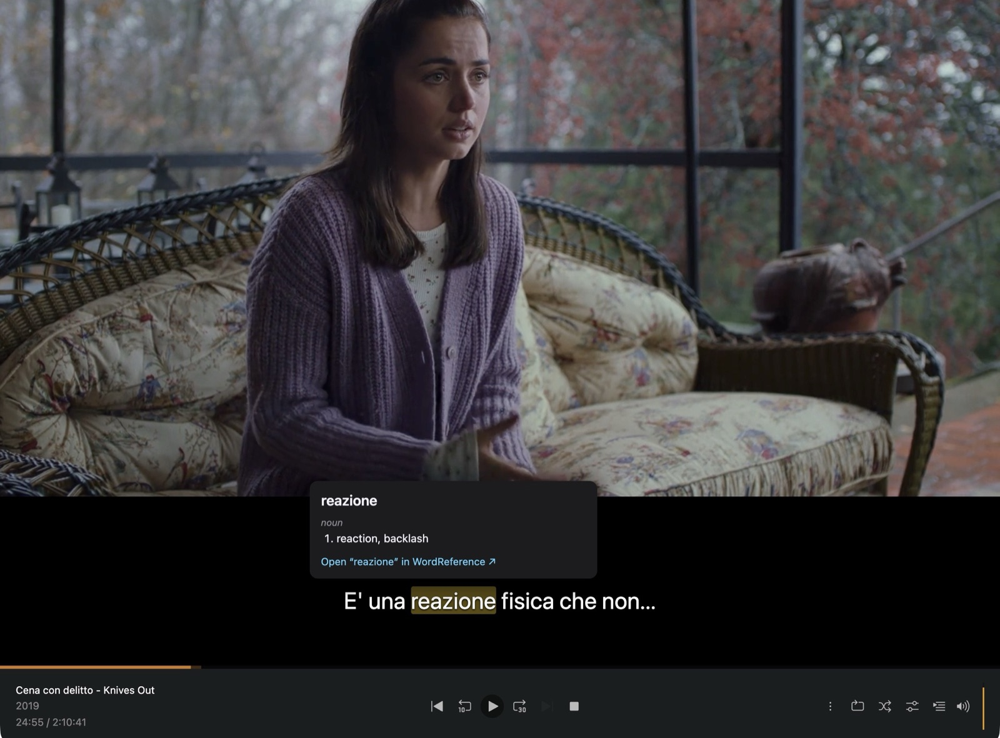

# Sottotitoli

**Learn Italian from what you watch on Plex.** Sottotitoli shows a film or show's Italian
subtitles as clickable words. Click any word to see what it means, without leaving the film.



- **Click any word** for its English meaning, its part of speech, and the dictionary form of
  conjugated or plural words (*parlavo* → *parlare*, *ragazze* → *ragazza*).
- **Works offline.** The Italian→English dictionary is built in (from Wiktionary), so lookups
  are instant and nothing you watch or click is sent anywhere.
- **Pauses for you.** The video pauses while your mouse is over the subtitle or a definition is
  open, then carries on.
- **One click to WordReference** for examples, idioms and forum discussions.
- **Uses your own subtitles.** It finds the Italian subtitle track in your Plex library
  automatically, or you can drag a subtitle file onto the player.

Works in Chrome, Edge, Brave, Arc and Firefox, with Plex Web (`app.plex.tv` or your server's own
web app).

## Install

Sottotitoli isn't in the Chrome Web Store or Firefox Add-ons yet, so you install it from a
download.

### Chrome, Edge, Brave, Arc

1. Download `sottotitoli-<version>-chrome.zip` from the
   [latest release](../../releases/latest) and unzip it.
2. Go to `chrome://extensions` and turn on **Developer mode** (top right).
3. Click **Load unpacked** and choose the unzipped folder.
4. Pin Sottotitoli to your toolbar and click it. The first time, it takes about a minute to load
   the dictionary. Wait until it says **Dictionary ready**.

To update later, unzip the new version over the same folder and click ↻ on the extension's card.

### Firefox (128 or later)

1. Download `sottotitoli-<version>-firefox.zip` from the [latest release](../../releases/latest).
2. Go to `about:debugging#/runtime/this-firefox`, click **Load Temporary Add-on…** and choose the
   zip.

Firefox removes temporary add-ons when it restarts. A signed version that stays installed is
planned.

## Using it

1. **Give your film or episode an Italian subtitle** (see below).
2. **Play it in Plex Web.** A message at the top of the video confirms the subtitles loaded,
   along with how many lines they have.
3. **Click any word.** Press `Esc` or click elsewhere to close the definition.

Plex's own subtitles are hidden automatically while Sottotitoli's are showing. Click the toolbar
icon to change the text size, turn off pausing on hover, or switch Sottotitoli off.

### Getting Italian subtitles into Plex

Sottotitoli needs a **text** subtitle in Italian: SRT, VTT or ASS.

- **Already in the file:** many MKVs come with an Italian subtitle track inside. If so, you're
  set.
- **Search from Plex:** on the film or episode's page in Plex Web, open the subtitles menu, choose
  **Search…** and pick an Italian result.
- **Add a file next to the video:** name it after the video, ending in `.it.srt`, e.g.
  `Knives Out (2019).it.srt`, then refresh the item's metadata in Plex. Sites like
  [OpenSubtitles](https://www.opensubtitles.org) have Italian subtitles for most films and
  series. [Bazarr](https://www.bazarr.media) can fetch them automatically for a whole library.
- **Quick test without changing anything in Plex:** drag a `.srt`, `.vtt` or `.ass` file onto
  the playing video.

Subtitles stored as images (PGS or VobSub, common on Blu-ray rips) can't be used, because
there's no text to click.

## Troubleshooting

| What you see | What to do |
| --- | --- |
| *"No Italian text subtitles found"* | The item has no Italian SRT/VTT/ASS track. Add one (see above) or drag a file onto the player. |
| *"Plex is burning its subtitles into the video"* | Plex is drawing its subtitles into the video while converting it, so they can't be hidden. Set subtitles to **None** in Plex's player. |
| A word says the dictionary is *still loading* | It's loading for the first time. Check progress in the toolbar popup. |
| Nothing happens at all | Sottotitoli runs on `app.plex.tv`, `*.plex.direct`, `localhost` and `127.0.0.1`. If you open Plex at a LAN address like `http://192.168.1.10:32400/web`, use `app.plex.tv` instead. |
| Subtitles are out of sync | The subtitle file doesn't match your copy of the video. Try a different release of the subtitles. |

## Privacy

Sottotitoli has no server, no analytics and no account. It reads subtitles from your own Plex
server using the sign-in Plex Web already has, and dictionary lookups happen inside your
browser. The only time anything leaves your browser is when you click a WordReference link.

## Development

Requires Node 22+ and pnpm.

```bash
pnpm install
pnpm dev            # Chrome with hot reload (opens a fresh browser profile)
pnpm dev:firefox    # Firefox
pnpm test           # unit tests (Vitest)
pnpm typecheck
pnpm build          # → dist/chrome-mv3   (pnpm build:firefox → dist/firefox-mv3)
pnpm zip            # → dist/sottotitoli-<version>-chrome.zip (pnpm zip:firefox for Firefox)
```

Pushing a `v*` tag runs the [release workflow](.github/workflows/release.yml), which tests,
builds and attaches the Chrome and Firefox zips to a GitHub release.

### How it works

- [`entrypoints/plex-hook.content.ts`](entrypoints/plex-hook.content.ts) runs in the page's own
  JavaScript context and watches Plex Web's requests to your server (the playback decision and
  `/:/timeline` reports). When something new starts playing, it fetches the item's metadata,
  picks the best Italian text subtitle stream and downloads it.
- [`entrypoints/plex.content/`](entrypoints/plex.content) parses the subtitles
  ([`lib/subtitles.ts`](lib/subtitles.ts)), draws the current line over the video in a shadow
  root, hides Plex's own subtitles and shows the definition popup.
- [`entrypoints/background.ts`](entrypoints/background.ts) loads the bundled dictionary into
  IndexedDB on first run and answers lookups. [`lib/lemma.ts`](lib/lemma.ts) handles what
  Wiktionary doesn't list directly: elisions (*dell'*) and pronouns attached to verbs
  (*parlarti* → *parlare*).

### Rebuilding the dictionary

```bash
mkdir -p data
curl -L -o data/kaikki-italian.jsonl.gz \
  https://kaikki.org/dictionary/Italian/kaikki.org-dictionary-Italian.jsonl.gz
pnpm build:dict
```

Then bump `DICT_VERSION` in [`lib/dictionary.ts`](lib/dictionary.ts) so installed copies
re-import it.

### Why Plex?

The first idea was SBS On Demand, but its Italian programmes have English subtitles burned
into the picture and no Italian text track, so there's nothing to click. RaiPlay does provide
Italian subtitle files, but most of its video is geo-blocked outside Italy. Support for other
players is welcome as long as they provide subtitle text in the language being learned.

## License

Code: [MIT](LICENSE). Dictionary data: [Wiktionary](https://www.wiktionary.org) contributors via
[kaikki.org](https://kaikki.org), [CC BY-SA 4.0](https://creativecommons.org/licenses/by-sa/4.0/).
Not affiliated with Plex, Inc.
